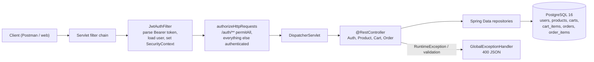
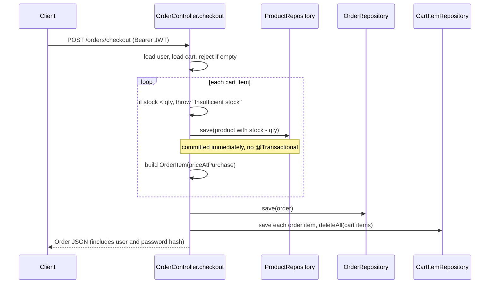
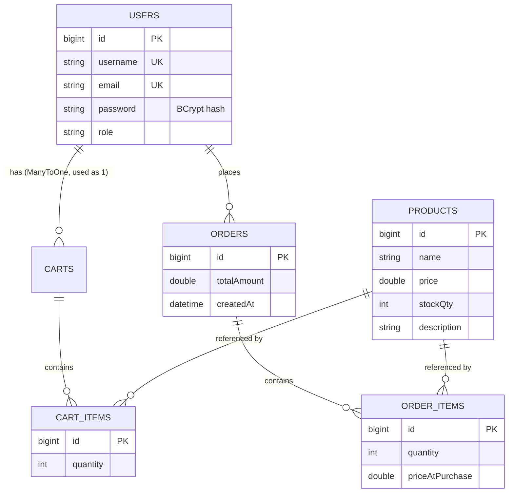

# E-CommerceAPI — Interview Deep-Dive

> **Who this is for:** me (the author), preparing to explain and defend this project in interviews.
> **How to read it:** plain English first, then technical depth. Terms are defined on first use, and there's a [Glossary](#glossary) at the end.
> **Ground rules:** checked against the code at HEAD `b2eef1f`. I **built and ran the API** after moving the flat `.java` files into a standard Maven layout (`src/main/java/<package>/…`), with an in-memory H2 database. The behaviour quoted in §8/§10 comes from real `curl` calls against it. Anything not evidenced is marked **UNVERIFIED**.

---

## 0. TL;DR

- **What:** a **Spring Boot 3.3.5 / Java 21 REST API** for a small e-commerce backend:
  - register/login with **BCrypt** passwords and **JWT** (HS256, 1-hour expiry);
  - product CRUD;
  - one cart per user (add/remove items);
  - **checkout**: validate stock, decrement inventory, snapshot the price into order items, clear the cart;
  - order history.
  - PostgreSQL 16 via Spring Data JPA/Hibernate. Docker + Docker Compose.
- **As committed it doesn't build**: all 26 `.java` files plus IDE files sit **flat in the repo root**, while `pom.xml` expects `src/main/java/…`. Once restructured, it compiles and runs.
- **Bugs I confirmed by running it:**
  1. **Password hashes leak:** `GET /cart`, `POST /cart/add/{id}`, `POST /orders/checkout` and `GET /orders` all return the full `User` entity, **including the BCrypt hash**.
  2. **Checkout isn't transactional:** a checkout that fails on item 2 (out of stock) had **already decremented item 1's stock** (5 → 4) and left it that way.
  3. **No authorisation:** any logged-in `USER` can create, update or delete products.
  4. **User enumeration:** login returns "Invalid username" vs "Invalid password".
  5. **A stale or garbage token makes even `/auth/login` fail (403)**, because the JWT filter throws on parse errors before `permitAll` applies.
  6. Database errors leak to clients: a duplicate email returns the raw SQL constraint message.
- **No tests** (the README says "API Testing: Postman").

---

## 1. One-paragraph pitch (30 seconds)

"It's a backend for an online shop, built with Spring Boot, Spring Security and PostgreSQL in Docker. Users register and log in with BCrypt-hashed passwords and get a stateless JWT. They can browse products, maintain a cart, and check out: the API validates inventory, decrements stock, snapshots the price at purchase time into order lines so later price changes don't rewrite history, and clears the cart. It's layered into controllers, repositories and entities, with a global exception handler and request validation. When I revisited it, I found and reproduced real issues, including a missing transaction on checkout and entity serialisation leaking password hashes, and I can walk through exactly how I'd fix them."

---

## 2. Plain-language explanation

An online shop has a website (what you see) and a **backend** (the system behind it that stores products, users and orders). This project is only the backend. It exposes **endpoints**, web addresses a website or app calls, like `POST /orders/checkout` to buy what's in your cart.

- **Logging in** gives you a **token** (a JWT), a signed digital pass you send with every request so the server knows who you are without keeping a session.
- **Passwords** are stored as **hashes** (scrambled with BCrypt), so even the database owner can't read them.
- **Checkout** checks there's enough stock, reduces it, records an order with the price you paid, and empties your cart.

The important bugs in plain terms:
- The server accidentally sends your scrambled password back in some replies.
- If checkout fails halfway, the stock count is already reduced for the earlier items.
- Any customer can edit or delete products.

---

## 3. Architecture

### 3.1 Components (by Java package)

| Package | Classes | Role |
|---|---|---|
| `com.sid.commerceapi` | `CommerceapiApplication` | Spring Boot entry point |
| `config` | `SecurityConfig` | Security filter chain, BCrypt bean, `AuthenticationManager` |
| `security` | `JwtUtil`, `JwtAuthFilter`, `CustomUserDetailsService` | Token creation/validation, per-request auth, user lookup |
| `controller` | `AuthController`, `ProductController`, `CartController`, `OrderController` | REST endpoints (cart and order logic lives here) |
| `service` | `ProductService` | The only service class |
| `repository` | `UserRepository`, `ProductRepository`, `CartRepository`, `CartItemRepository`, `OrderRepository`, `OrderItemRepository` | Spring Data JPA interfaces |
| `entity` | `User`, `Product`, `Cart`, `CartItem`, `Order`, `OrderItem` | JPA entities, also returned directly as JSON |
| `dto` | `RegisterRequest`, `LoginRequest`, `AuthResponse` | Request/response bodies with Bean Validation |
| `exception` | `GlobalExceptionHandler` | Maps `RuntimeException` and validation errors to 400 |
| infra | `pom.xml`, `application.properties`, `Dockerfile`, `docker-compose.yml`, `mvnw` | Build, config, containers |

### 3.2 Request flow



### 3.3 Checkout sequence (as implemented)



### 3.4 Data model



---

## 4. Tech stack

| Choice | Why | Alternatives & trade-offs |
|---|---|---|
| **Spring Boot 3.3.5, Java 21** | Industry-standard, batteries included (web, data, security, validation) | Quarkus/Micronaut (faster startup); Node/Express or FastAPI (lighter, different ecosystem) |
| **Spring Security + JWT (jjwt 0.12.5)** | Stateless auth, which suits horizontal scaling | Server sessions + cookies (simpler revocation, CSRF concerns); OAuth2/OIDC provider (Keycloak, Auth0) |
| **BCrypt** | Adaptive, salted password hashing | Argon2id (memory-hard, current OWASP first choice) |
| **Spring Data JPA / Hibernate** | Repository interfaces, derived queries | jOOQ/MyBatis (explicit SQL, fewer ORM surprises) |
| **PostgreSQL 16** | ACID, row-level locking (needed for inventory) | MySQL |
| **H2** (runtime dependency) | Leftover from early development; a `commerce_db.mv.db` + trace file are committed | — |
| **Docker + Compose** | One command for app + DB | Kubernetes (overkill here); Testcontainers for tests |
| **Bean Validation** | `@NotBlank`, `@Email`, `@Size` on DTOs | Manual checks |
| **Lombok** | In `pom.xml`, but entities use hand-written getters/setters | Java records for DTOs |

---

## 5. Code walkthrough

> File paths are the repo-root files. Each file declares its package, e.g. `CartController.java` → `com.sid.commerceapi.controller`.

### 5.1 Security
- **`SecurityConfig.java` (`:28-52`):** CSRF disabled (fine for stateless bearer tokens), `STATELESS` sessions, `/auth/**` is `permitAll`, everything else needs authentication, and `JwtAuthFilter` runs before `UsernamePasswordAuthenticationFilter`. BCrypt `PasswordEncoder` bean (`:54-58`).
  - *Missing:* a custom `AuthenticationEntryPoint`, so unauthenticated requests get **403** instead of 401.
- **`JwtUtil.java`:**
  - the HMAC key comes from a **hard-coded string** (`:17-20`);
  - `generateToken` gives subject = username, iat, and exp = now + 1 h, signed HS256 (`:23-33`);
  - `isTokenValid` checks the subject and expiry (`:42-48`);
  - parsing uses `Jwts.parser().verifyWith(key).build().parseSignedClaims` (`:60-66`), which **throws** on a bad signature, malformed token or expiry.
- **`JwtAuthFilter.java` (`:28-74`):** if the header starts with `Bearer `, it extracts the username (which can throw), loads the user, validates, and sets the `SecurityContext`.
  - ⚠️ The filter runs for **every** request, including `/auth/login`. A malformed or expired token therefore turns the login request itself into a 403 (verified). The parse should be wrapped in try/catch and skipped for `/auth/**`.
- **`CustomUserDetailsService.java`:** maps `User` to Spring's `UserDetails` with authority `ROLE_<role>`.

### 5.2 `AuthController.java`
- **`/auth/register` (`:29-49`):**
  - checks username uniqueness (returns a **200 with "Username already exists"** instead of 409);
  - hashes with BCrypt, sets role `USER`, saves.
  - A duplicate **email** isn't checked, so the DB unique constraint fires and the raw SQL error is returned (verified).
- **`/auth/login` (`:51-73`):** separate "Invalid username" / "Invalid password" messages (enumeration). Both throw `RuntimeException`, so the client gets **400** rather than 401.

### 5.3 Products: `ProductController.java` + `ProductService.java`
- Full CRUD.
  - `getProductById` returns `null` → **200 with an empty body** for a missing id (`ProductService.java:26-28`).
  - `updateProduct` likewise returns null (`:30-44`).
- **No role check:** any authenticated user can POST/PUT/DELETE products (verified as a `USER`).
- `@RequestBody Product` binds straight onto the entity: **mass assignment**. A client can send `id`, and there's no validation (negative price or stock is accepted).

### 5.4 Cart: `CartController.java`
- `POST /cart` (`:36-55`) creates one cart per user (duplicates rejected by a lookup, not by a DB constraint).
- `POST /cart/add/{productId}` (`:73-125`) increments quantity or creates a line. It doesn't check stock.
- `POST /cart/remove/{productId}` (`:128-171`) decrements or deletes.
- All return the `Cart` entity, which includes `user` → **password hash** (verified).
- *Design:* all the business logic sits in the controller; there's no `CartService`. `Cart.user` is `@ManyToOne` though the intent is one-to-one.

### 5.5 Orders: `OrderController.java`
- **`checkout` (`:39-128`):** load user and cart; reject empty; for each item, check stock, **`productRepository.save` with reduced stock** (`:79-84`), build an `OrderItem` with **`priceAtPurchase`** (`:94-95`) and sum the total. Then save the order, save the items, `deleteAll` the cart items, and clear the collection.
  - ⚠️ **No `@Transactional`**: each `save` commits on its own. A failure mid-loop leaves earlier stock decrements committed. **Reproduced:** stock 5 → 4 after a failed checkout.
  - ⚠️ **No concurrency control**: two simultaneous checkouts can both read stock = 1 and both succeed (lost update / oversell). Fixes: a transaction + `SELECT … FOR UPDATE` (`@Lock(PESSIMISTIC_WRITE)`), an `@Version` optimistic lock, or a conditional `UPDATE … SET stock = stock - ? WHERE id = ? AND stock >= ?`.
  - Money is `Double` (rounding errors); should be `BigDecimal` / integer paise.
- `GET /orders` (`:131-141`) returns the user's orders, again with the user entity and its hash.

### 5.6 Entities and JSON
- Bidirectional relations use `@JsonManagedReference` / `@JsonBackReference` to avoid infinite recursion (Cart ↔ CartItem, Order ↔ OrderItem).
- **`User` has a public `getPassword()` and no `@JsonIgnore`**, so Jackson serialises the hash wherever a `User` is reachable.
- `ddl-auto=update` in `application.properties`: schema migrations are implicit (no Flyway/Liquibase).

### 5.7 `GlobalExceptionHandler.java`
- `RuntimeException` → 400 with `ex.getMessage()` (`:18-31`). That's why DB errors leak and why "not found" and "unauthorised" all look like 400.
- `MethodArgumentNotValidException` → 400 with a field → message map (`:34-58`).

### 5.8 Infra
- `Dockerfile` copies a **pre-built** `target/commerceapi-0.0.1-SNAPSHOT.jar` (a JDK image, no multi-stage build), so you must run `mvn package` first.
- `docker-compose.yml`: Postgres 16 (port 5432 exposed, named volume) + backend on 8081. **Credentials are in plain text** (also the defaults in `application.properties`). `depends_on` has no health check, so the app can start before Postgres is ready.

---

## 6. Core concepts & theory

### 6.1 Stateless auth with JWT
- A JWT has the form `base64url(header).base64url(payload).signature`. With HS256 the signature is $\text{HMAC-SHA256}(key, header.payload)$.
- The server verifies the signature and `exp` with no DB session. Revocation is hard (use short expiry + refresh tokens, or a denylist).
- **Secret management:** the key must come from the environment or a vault and be ≥ 256 bits of randomness, not a readable string in source.

### 6.2 Password hashing
- BCrypt cost factor 10 (default) gives 2¹⁰ rounds of the expensive key setup. It's salted per hash, so identical passwords produce different hashes.
- A leaked hash still enables **offline brute force**, which is why exposing it in API responses matters even though it's "just a hash".

### 6.3 Transactions and ACID
- Atomicity: all of checkout's writes should commit together or not at all.
- Spring's `@Transactional` on a service method opens a transaction (proxy-based, so self-invocation bypasses it). A `RuntimeException` triggers rollback by default.
- **Isolation & lost updates:** read-modify-write on `stockQty` under READ COMMITTED (the Postgres default) lets two transactions both decrement from the same value.
  - Pessimistic: `SELECT … FOR UPDATE`.
  - Optimistic: an `@Version` column with retry.
  - Atomic SQL: `UPDATE products SET stock = stock - :q WHERE id = :id AND stock >= :q` and check the affected rows.

### 6.4 REST semantics
- Correct codes: 201 Created, 401 Unauthenticated, 403 Forbidden, 404 Not Found, 409 Conflict.
- `POST /cart/remove/{id}` should arguably be `DELETE /cart/items/{id}`.
- Idempotency matters for checkout: use an `Idempotency-Key` header so client retries don't create duplicate orders.

### 6.5 DTOs vs entities
- Returning JPA entities couples the API to the schema, risks lazy-loading exceptions and N+1 queries, and leaks fields (as here).
- The standard fix is response DTOs/records with explicit fields, and request DTOs with validation (no mass assignment).

### 6.6 Price snapshotting
- `OrderItem.priceAtPurchase` stores the price at order time, so editing a product later doesn't rewrite past orders. That's correct and a good design point to mention.

---

## 7. Data

- **Schema:** generated by Hibernate (`ddl-auto=update`). Tables: `users`, `products`, `carts`, `cart_items`, `orders`, `order_items` (§3.4).
- **Seed data:** none. Products are created through the API.
- **Committed artefacts:**
  - `commerce_db.mv.db` (an H2 database file);
  - `commerce_db.trace.db` (an H2 crash log: `MVStoreException … AssertionError`);
  - IntelliJ files (`workspace.xml`, `.iml`, `compiler.xml`, `misc.xml`…).
- No ML data and no train/test concepts. "Leakage" here means **data exposure** (§10).

---

## 8. Evaluation & results

- **Automated tests:** none (`spring-boot-starter-test` is declared but there's no `src/test`).
- **What I verified by running it (Java 21, Maven, H2 in memory, 15 Oct 2026):**

| Check | Result |
|---|---|
| Builds after restructuring into `src/main/java` | ✅ `mvn package` succeeds |
| Register, login, JWT, protected routes | ✅ work |
| `GET/POST /cart…`, `POST /orders/checkout`, `GET /orders` | ❌ JSON includes `"password":"$2a$10$…"` |
| Failed checkout (2nd item out of stock) | ❌ the 1st item's stock went 5 → 4 and stayed |
| Regular `USER` creates products | ❌ allowed |
| Login with unknown user vs wrong password | ❌ distinguishable messages (both 400) |
| `/auth/login` with a garbage `Authorization: Bearer` header | ❌ 403 |
| No token on a protected route | 403 (should be 401) |
| Duplicate email on register | ❌ 400 with the raw SQL constraint text |

- **Performance/load:** not measured.

---

## 9. Design decisions & trade-offs

| Decision | Gained | Lost |
|---|---|---|
| JWT stateless auth | No session store; scales horizontally | No easy revocation; 1-hour tokens with no refresh flow |
| Entities as API models | Very little code | Data leaks, tight coupling, mass assignment |
| Logic in controllers | Quick to write | Hard to test; no transactional boundary |
| `ddl-auto=update` | Zero migration effort | Unsafe schema drift in production |
| `Double` for money | Simple | Rounding errors |
| Price snapshot on order items | Historical correctness | — |
| Docker Compose | One-command local stack | Secrets in YAML; no health checks |

---

## 10. Honest weaknesses

1. **Password-hash exposure** in every cart/order response. *Verified.*
2. **Non-atomic checkout.** Partial inventory decrements persist on failure. *Verified.*
3. **Overselling under concurrency:** there's no locking on stock read-modify-write. *By analysis.*
4. **No authorisation:** roles exist but are never checked, so any user can manage the catalogue. *Verified.*
5. **Hard-coded JWT secret** (`JwtUtil.java:17-18`) and plain-text DB credentials in `application.properties` / `docker-compose.yml`.
6. **The JWT filter breaks `/auth/**`** when a bad token is present (exceptions thrown in the filter). *Verified* (403 on login).
7. **Wrong status codes and leaky errors:** 400 for auth failures, 200-with-message for duplicate usernames, 200-empty for missing products, and SQL text in responses.
8. **User enumeration** on login.
9. **Repo doesn't build as committed** (flat layout). It also contains IDE files and an H2 DB/crash log. No `.gitignore` for `target/`.
10. **No tests, no CI, no migrations, no pagination** (`findAll` on products), and no stock check when adding to the cart.
11. README claims a "Service / Business Logic" layer, but only `ProductService` exists.

---

## 11. How I'd improve it (prioritised)

| # | Change | Effort | Impact |
|---|---|---|---|
| 1 | **Response DTOs** (or `@JsonIgnore` on `password` as a stop-gap) | 1–2 hours | Stops the credential leak |
| 2 | Move checkout into an `OrderService` with **`@Transactional`**, plus **atomic conditional stock UPDATE** or `@Lock(PESSIMISTIC_WRITE)`; add an idempotency key | 0.5 day | Correct inventory under failure and concurrency |
| 3 | **RBAC:** `ROLE_ADMIN` for product writes (`@PreAuthorize("hasRole('ADMIN')")` or matchers) | 1 hour | Closes privilege escalation |
| 4 | JWT secret from the environment (≥ 32 random bytes); catch JWT exceptions in the filter, skip `/auth/**`; add a 401 entry point; uniform "invalid credentials" message | 2 hours | Correct auth semantics |
| 5 | Proper exception taxonomy (`NotFoundException` → 404, `ConflictException` → 409); never echo raw exception messages | 2 hours | Clean API, no info leak |
| 6 | Restructure into `src/main/java`, add `.gitignore`, delete IDE/H2 files; multi-stage Dockerfile; Compose health check | 1 hour | Builds from a clean clone |
| 7 | **Tests:** `@WebMvcTest` for controllers, `@DataJpaTest`, **Testcontainers Postgres** integration test for checkout (incl. a concurrent-checkout test); GitHub Actions CI | 1–2 days | Regression safety |
| 8 | Flyway migrations; `BigDecimal` money; pagination; validation on Product | 1 day | Production-readiness |
| 9 | Refresh tokens / short-lived access tokens; rate limiting on `/auth/login` | 1 day | Security hardening |

---

## 12. How to run it

The repo as committed needs restructuring first:
```bash
# move each file to src/main/java/<package path>/ based on its `package` line,
# and application.properties to src/main/resources/
mvn -DskipTests package
docker compose up --build        # Postgres 16 + app on :8081
```
Or locally against Postgres with the env vars below, or against H2 by overriding `spring.datasource.url=jdbc:h2:mem:commerce` (what I did).

**Env vars (names only):**
- `SPRING_DATASOURCE_URL`
- `SPRING_DATASOURCE_USERNAME`
- `SPRING_DATASOURCE_PASSWORD`

The JWT secret is currently hard-coded. It should become e.g. `JWT_SECRET`.

**Smoke test:**
```bash
curl -X POST :8081/auth/register -H 'Content-Type: application/json' -d '{"username":"u","email":"u@x.com","password":"secret12"}'
curl -X POST :8081/auth/login    -H 'Content-Type: application/json' -d '{"username":"u","password":"secret12"}'
```

---

## 13. Resume bullets (truthful)

- Built a **Spring Boot 3 / Java 21 REST API** for e-commerce: JWT stateless auth with BCrypt, product catalogue, per-user carts, and a checkout that validates inventory and **snapshots purchase prices** into order lines. **PostgreSQL 16** via JPA, containerised with **Docker Compose**.
- *(After fixing §11.1–3)* Hardened the checkout path with **transactional, lock-protected inventory updates** and replaced entity serialisation with DTOs after **reproducing a credential-exposure bug and a partial-commit inventory bug** in a local audit.

> ⚠️ Don't call it "production-style" until §10.1–4 are fixed. An interviewer can find the password leak in 30 seconds with Postman.

---

## Glossary

- **REST API / endpoint**: a URL + HTTP method that a client calls to read or change data.
- **JWT**: JSON Web Token, a signed token carrying who you are and when it expires.
- **BCrypt**: a slow, salted password-hashing algorithm.
- **JPA / Hibernate / ORM**: maps Java classes to database tables.
- **Entity vs DTO**: database-mapped class vs a plain object shaped for the API.
- **Transaction (ACID)**: a group of DB writes that succeed or fail together.
- **Lost update / overselling**: two concurrent updates where one silently overwrites the other.
- **Pessimistic vs optimistic locking**: lock rows before updating vs detect conflicts with a version number.
- **RBAC**: role-based access control.
- **User enumeration**: an attacker learning which usernames exist from error differences.
- **Mass assignment**: binding client JSON directly onto internal objects, letting clients set fields they shouldn't.
